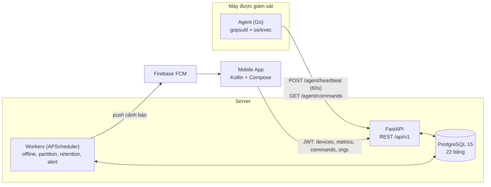

# Kiến trúc hệ thống DMS

## 1. Tổng quan



Agent luôn **chủ động gọi ra** (pull/poll) → máy giám sát không cần mở port, đi qua NAT/firewall được.

## 2. Phân tầng Backend (Clean-ish layering)

```
Router (api/v1/routers)   → nhận request, validate bằng Pydantic, gọi service
   ↓
Service (services/)       → business logic, kiểm tra quyền, ghi audit_logs
   ↓
Model/ORM (models/, db/)  → SQLAlchemy async, truy vấn
   ↓
PostgreSQL
```
Quy tắc: router **không** chứa SQL/logic; service **không** biết HTTP.

## 3. Xác thực & phân quyền

| Đối tượng | Cách xác thực | Ghi chú |
|---|---|---|
| Người dùng (Mobile) | JWT access (15') + refresh token (lưu `sha256` trong `auth_tokens`, rotate on use) | bcrypt cost ≥ 12 |
| Agent | `Authorization: Bearer <secret_token>` → so `sha256(token)` với `devices.secret_token_hash` | Token hiển thị **một lần** khi tạo thiết bị, DB chỉ lưu hash + prefix 8 ký tự |

Phân quyền **2 cấp** (theo schema):
1. **Org**: `org_members.role` ∈ Owner / Admin / Manager / Viewer. Owner & Admin thấy toàn bộ org.
2. **Group**: `user_group_access.role` ∈ Manager / Viewer — Manager/Viewer chỉ thấy cụm được gán.

| Hành động | Owner | Admin | Manager (cụm) | Viewer (cụm) |
|---|:-:|:-:|:-:|:-:|
| Xóa org / chuyển Owner | ✅ | | | |
| Quản lý thành viên, invite, thiết bị | ✅ | ✅ | | |
| Gửi lệnh REBOOT/KILL/RESTART | ✅ | ✅ | ✅ | |
| Xem metrics, alert | ✅ | ✅ | ✅ | ✅ |

**Mọi truy vấn phải lọc theo `org_id`** (multi-tenant isolation) — đặt trong dependency `require_org_role`, không rải rác trong từng endpoint.

## 4. Luồng dữ liệu chính

**Heartbeat:** Agent → `POST /agent/heartbeat` → xác thực token → `INSERT device_metrics`, cập nhật `devices.last_heartbeat` + `status` → (nếu cần) đánh giá `alert_rules`.

**Lệnh từ xa:** Mobile `POST /devices/{id}/commands` (bắt buộc `reason`) → `device_commands.status=PENDING` + `audit_logs` → Agent poll `GET /agent/commands` → `EXECUTING` → chạy whitelist → `POST /agent/commands/{id}/result` → `SUCCESS/FAILED`. Worker đổi sang `TIMEOUT` sau 5 phút.

**Offline:** Worker mỗi phút: `now - last_heartbeat > offline_threshold_minutes` → `Offline` + `alert_history` + FCM.

**Dữ liệu lớn:** `device_metrics` partition theo tuần; Worker tạo partition tuần sau và `DROP` partition > 7 ngày. Biểu đồ 7 ngày đọc raw, biểu đồ dài hơn đọc `device_metrics_hourly` (giữ 90 ngày).

## 5. Bảo mật bắt buộc

- Agent **chỉ chạy whitelist** `REBOOT`, `RESTART_SERVICE`, `KILL_PROCESS`; validate tham số (pid là số, service_name theo regex). Không bao giờ `exec` chuỗi tự do từ server.
- Dùng HTTPS ở production (kể cả khi demo qua ngrok).
- Rate limit `/auth/*` và `/agent/heartbeat`; invite code có `max_uses`/`expires_at`.
- Mọi hành động nhạy cảm ghi `audit_logs`.

## 6. Phân chia module & sở hữu

| Thư mục | Chủ sở hữu | Công nghệ |
|---|---|---|
| `backend/`, `database/`, `docs/` | Dev 1 | FastAPI, SQLAlchemy async, PostgreSQL |
| `agent/` | Dev 2 | Go 1.22, gopsutil |
| `mobile/` | Dev 3 | Kotlin, Compose, Retrofit, Vico, FCM |

Ba module chỉ giao tiếp qua **`docs/API_CONTRACT.md`** (và OpenAPI tại `/docs`). Đổi contract = tạo PR và tag cả hai bên review.
